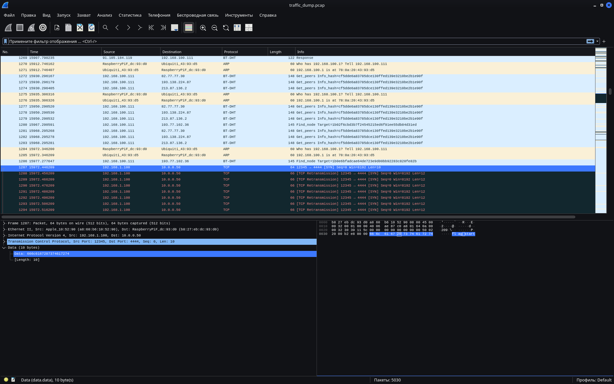
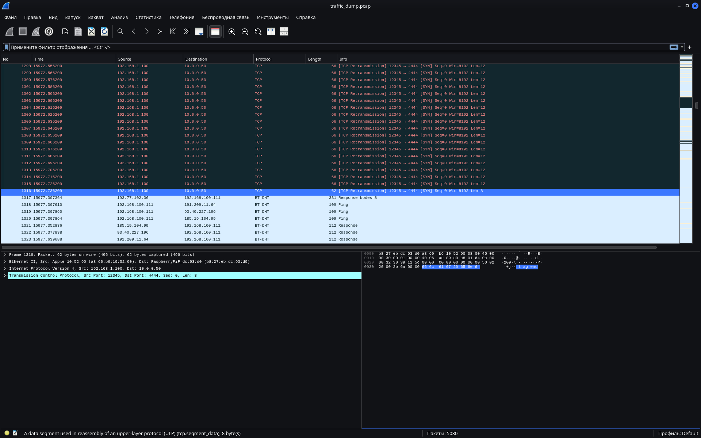
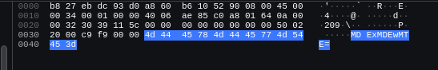

# Hidden stream | Easy | forensic

## Информация

> Нам поступила информация, что некая организация Y смогла взломать суперкомпьютер лаборатории Х и наладить канал связи для кражи секретных данных. Учёные лаборатории уже нашли вирус, теперь осталось найти этот канал и узнать какие данные были украдены

## Деплой

`Не требуются`

## Выдать участникам

[`traffic_dump.zip`](public/traffic_dump.zip) из директории [public/](public/)

## Описание

Дамп трафика с внедрёнными пакетами спрятанного канала связи

## Решение

1. Открываем файл `traffic_dump.pcap` через wireshark
2. Ищем любое упоминание флага ("flag").
3. Можно найти диалог начинающийся с пакета в data которого есть строчка `flag start` 
4. Так же можно заметить что диалог кончается строчкой `flag end` 
5. Делаем вывод, что мы нашли наш канал связи, осталось лишь расшифровать его. Внутри каждого пакета лежит base64-строка 
6. Делаем вывод, что внутри каждого пакета лежит base64 от бинарной строки символа
7. Пишем скриптик который пройдётся по пакетам, сделает base64 decode и переведёт бинарную строку в символ
8. После запуска получаем искомый флаг `kevactf{C4tch_me_1f_y0u_can}`

[Эксплойт](solve/exploit.py)

## Флаг

`kevactf{C4tch_me_1f_y0u_can}`

## no-docker